<div align="center">

<picture>
  <source media="(prefers-color-scheme: dark)" srcset="docs/images/mascot/mascot-dark.svg">
  
</picture>

<h1>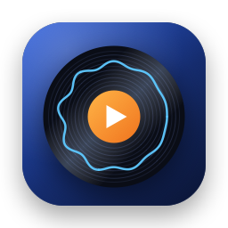 Amamac</h1>

**A native macOS music player in the spirit of Amarok.**

[](LICENSE)
[](#requirements)
[](https://www.swift.org)
[](https://github.com/MaxNoStar/amamac/releases/latest)

</div>

<picture>
  <source media="(prefers-color-scheme: dark)" srcset="docs/images/screenshots/hero-dark.png">
  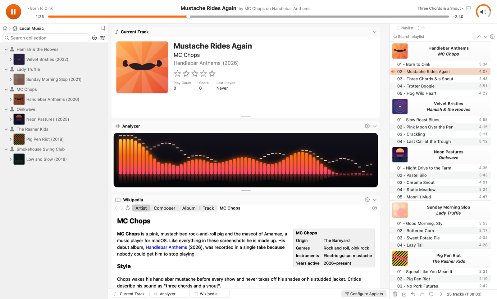
</picture>

<table>
  <tr>
    <td colspan="3" align="center" valign="top">
      <picture>
        <source media="(prefers-color-scheme: dark)" srcset="docs/images/screenshots/context-dark.png">
        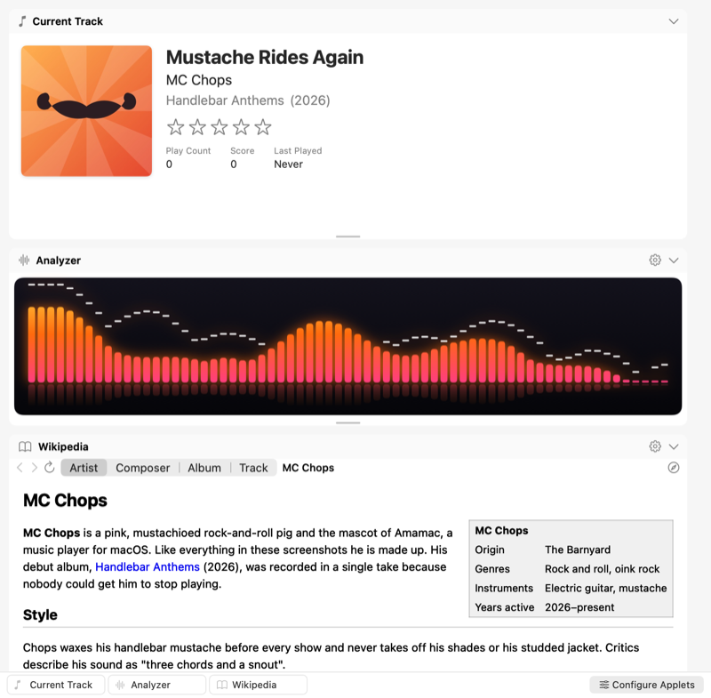
      </picture>
      <br><sub><b>Context view</b>: the current track, the analyzer and Wikipedia</sub>
    </td>
    <td colspan="3" align="center" valign="top">
      <picture>
        <source media="(prefers-color-scheme: dark)" srcset="docs/images/screenshots/analyzer-aurora-dark.png">
        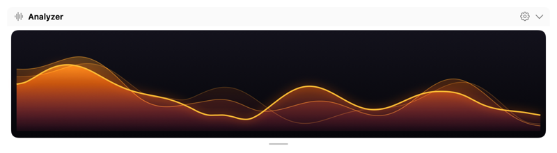
      </picture><br>
      <picture>
        <source media="(prefers-color-scheme: dark)" srcset="docs/images/screenshots/analyzer-halo-dark.png">
        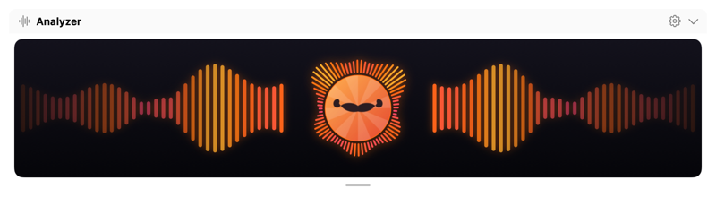
      </picture><br>
      <picture>
        <source media="(prefers-color-scheme: dark)" srcset="docs/images/screenshots/analyzer-ledMatrix-dark.png">
        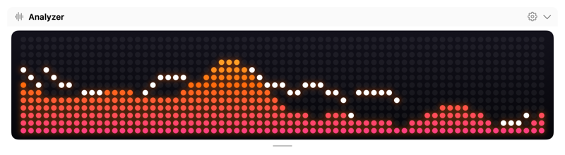
      </picture>
      <br><sub><b>Seven analyzer styles</b>, here Aurora, Halo and LED matrix</sub>
    </td>
  </tr>
  <tr>
    <td colspan="2" align="center" valign="top">
      <picture>
        <source media="(prefers-color-scheme: dark)" srcset="docs/images/screenshots/collection-dark.png">
        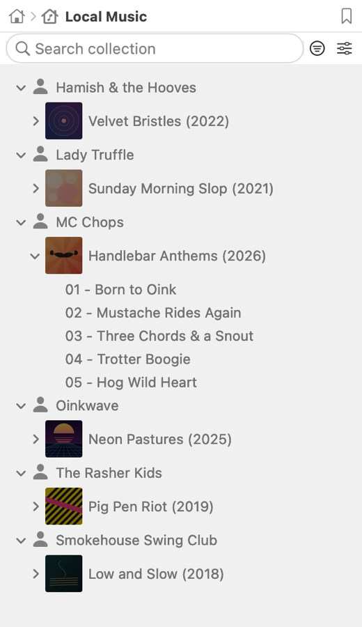
      </picture>
      <br><sub><b>Collection</b> by artist and album</sub>
    </td>
    <td colspan="2" align="center" valign="top">
      <picture>
        <source media="(prefers-color-scheme: dark)" srcset="docs/images/screenshots/dynamic-dark.png">
        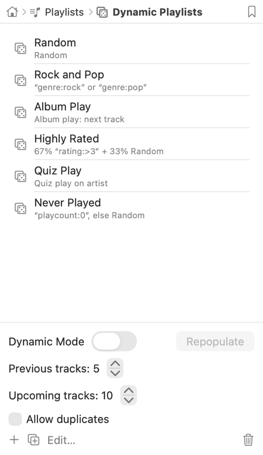
      </picture>
      <br><sub><b>Dynamic playlists</b> that keep the music coming</sub>
    </td>
    <td colspan="2" align="center" valign="top">
      <picture>
        <source media="(prefers-color-scheme: dark)" srcset="docs/images/screenshots/radio-dark.png">
        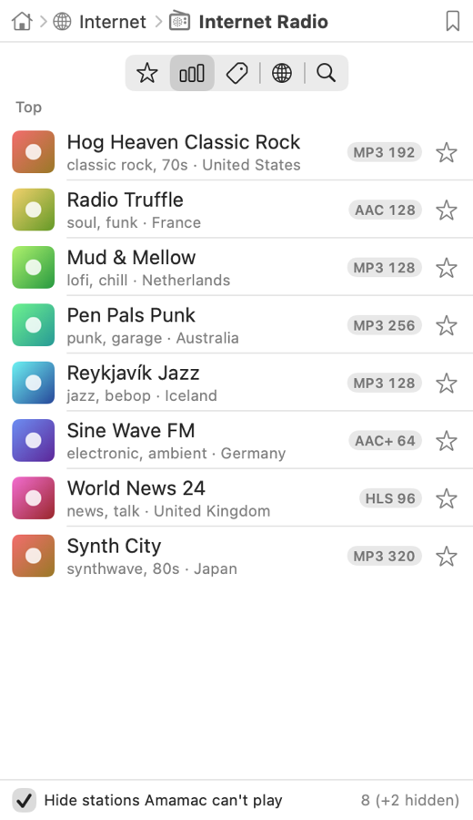
      </picture>
      <br><sub><b>Internet radio</b> and podcasts</sub>
    </td>
  </tr>
  <tr>
    <td colspan="3" align="center" valign="top">
      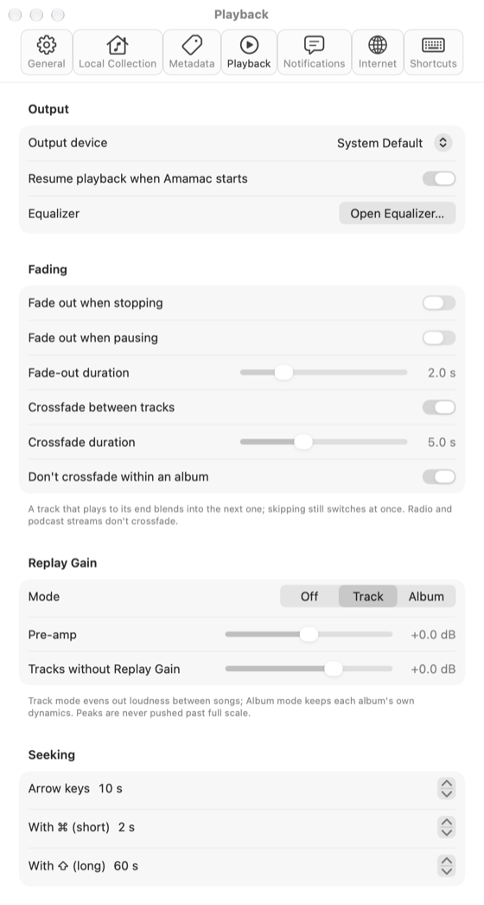
    </td>
    <td colspan="3" align="center" valign="top">
      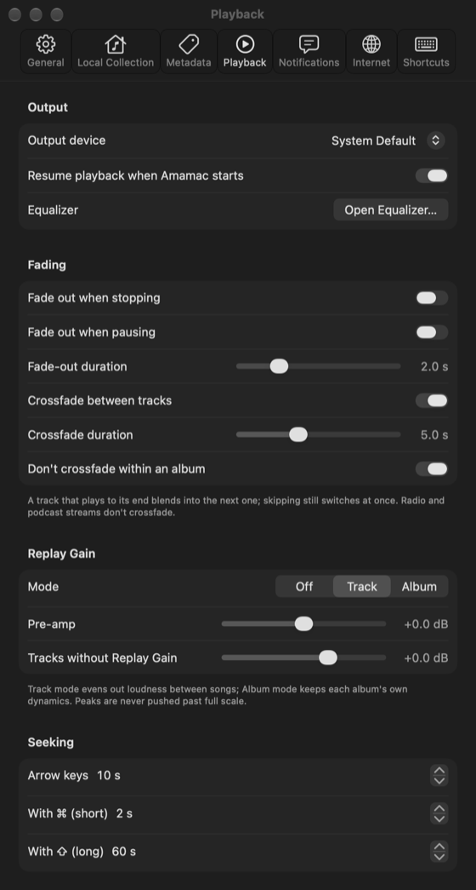
    </td>
  </tr>
  <tr>
    <td colspan="6" align="center">
      <sub><b>Light and dark</b>: Amamac follows the system appearance. Here Settings › Playback, with crossfading.</sub>
    </td>
  </tr>
</table>

<p align="center"><sub>Every screenshot shows a made-up library (<code>make screenshots</code>); no real artists or albums.</sub></p>

## Why Amamac

Amarok 2 put everything a music lover needs into one window: your collection on the left, the music's
context in the middle and a smart, album-grouped playlist on the right. Amamac brings that way of
listening to the Mac as a native app for Apple Silicon. It plays your own files gaplessly, knows a
lot about them, and has no accounts, ads or subscriptions.

## Features

- 📚 **Collection**: watched folders and fast incremental scans; Amarok's filter language
  (`artist:beatles year:>1990 -live`, `rating:>3.5`, `added:<2w`); configurable grouping, covers,
  ratings, scores and play counts; Edit Track Details with MusicBrainz lookup; Organize Files;
  Cover Manager; statistics import from Apple Music.
- 🎧 **Playback**: gapless FLAC, ALAC, AAC, MP3, Ogg Vorbis, Opus, WavPack, Musepack, TTA, DSD,
  tracker modules and more (via SFBAudioEngine); a 10-band equalizer with presets; ReplayGain;
  fades and crossfades (albums can stay gapless); output device choice; media keys and Now Playing.
- 📝 **Playlist**: album grouping and four layouts, multi-level sort, progressive search, queue,
  stop-after, undo, repeat and random modes (tracks or albums, with Favor), saved playlists,
  M3U/PLS/XSPF/ASX, dynamic playlists with biases and the Automated Playlist Generator.
- 🎛️ **Context**: Current Track, Albums, Wikipedia and a spectrum analyzer with seven styles
  (Block, Neon bars, Mirror, Halo, Aurora, LED matrix, Waterfall) and four colour palettes.
- 📻 **Internet**: radio stations from radio-browser.info; podcasts with downloads and OPML.
- 🖥️ **Desktop**: on-screen display, menu bar icon, global shortcuts, notifications, bookmarks and
  `amamac://` links, a Files browser.

## Meet MC Chops


Amarok has its wolf; Amamac has **MC Chops**, a pink rock-and-roll pig with a handlebar mustache he
waxes before every show, shades he never takes off and an electric guitar he won't put down. He stars
in every screenshot above (silently: his albums are made up) and on the project's social preview.

<br clear="left">

## Requirements

- A Mac with Apple Silicon (M1 or later)
- macOS 26 or later

## Installing

1. Download `Amamac-<version>.dmg` from the [latest release](https://github.com/MaxNoStar/amamac/releases/latest).
2. Open it and drag **Amamac** onto **Applications**.
3. The first time only: Amamac is signed ad hoc, not notarized by Apple, so macOS stops the first
   launch with "Apple could not verify Amamac". Click **Done**, open **System Settings › Privacy &
   Security**, scroll down to *Security* and click **Open Anyway** next to the message about
   Amamac, then confirm. From then on it opens normally. (The old right-click › Open shortcut no
   longer gets past Gatekeeper since macOS 15.)

## Building from source

You need Xcode 27 and [XcodeGen](https://github.com/yonaskolb/XcodeGen).

```bash
brew install xcodegen
git clone https://github.com/MaxNoStar/amamac.git
cd amamac
make project      # generate Amamac.xcodeproj from project.yml
make build        # Debug build (full log in build/last-build.log)
make run          # build and open the app
```

| Command | What it does |
|---|---|
| `make test` | core unit tests (no network; online clients get canned answers) |
| `make test-engine` | real playback through the default output device, muted |
| `make snapshot` | renders the window, panes and dialogs to `$TMPDIR/amamac-snapshot` |
| `make screenshots` | renders the README screenshots from the made-up showcase library |
| `make dmg` | Release build packed into `build/Amamac-<version>.dmg` |

Builds are signed ad hoc ("Sign to Run Locally"), so macOS may ask again for access to Music,
Documents or external drives after a rebuild. `CLAUDE.md` describes the code layout and the rules
the project follows.

## Privacy and security

- **No accounts, no analytics.** Lookups go to Wikipedia/Wikidata, MusicBrainz, the Cover Art
  Archive, the iTunes Search API and radio-browser.info, and send only titles, artists and album
  names, with the User-Agent `Amamac/<version> (macOS music player)`.
- **Your data stays on your Mac**: the library database, playlists and settings in
  `~/Library/Application Support/Amamac/`, cached web lookups (deleted after 30 days) in its
  `Caches/http` folder, podcast downloads in `~/Music/Podcasts`.
- **Hardened runtime**: other programs can't inject code into Amamac, and Release builds can't be
  attached to by debuggers.
- **Outside data is checked before use**: tags, playlist files, feeds and `amamac://` links can't
  move files out of a collection folder, pull in anything but audio files and http(s) streams, or
  crash the app with huge or malformed numbers. A secure https address is never redirected to an
  insecure one, and podcast downloads are quarantined like browser downloads.
- Amamac isn't sandboxed: it reads your collection folders and any file you open in it.

## Documentation

- [docs/PROGRESS.md](docs/PROGRESS.md): what's built, milestone by milestone, and the release notes
- [THIRD_PARTY_NOTICES.md](THIRD_PARTY_NOTICES.md): the open-source components and their licenses
  (also under Help › Acknowledgements)
- Found a bug? [Open an issue](https://github.com/MaxNoStar/amamac/issues/new/choose).

## Credits

Amamac is inspired by [Amarok](https://amarok.kde.org), KDE's music player, and rebuilds its
documented behaviour from scratch in Swift. It is an independent project, not affiliated with KDE,
and contains no Amarok code, data or artwork; the app icon and MC Chops are original.

It builds on [SFBAudioEngine](https://github.com/sbooth/SFBAudioEngine) and its codec libraries,
[TagLib](https://taglib.org), [GRDB](https://github.com/groue/GRDB.swift),
[FeedKit](https://github.com/nmdias/FeedKit) and
[KeyboardShortcuts](https://github.com/sindresorhus/KeyboardShortcuts), and on the open data of
Wikipedia, MusicBrainz, the Cover Art Archive and radio-browser.info.

## License

Amamac is released under the [MIT License](LICENSE): fork it, use it, have fun with it. The
components it bundles keep their own licenses, listed in
[THIRD_PARTY_NOTICES.md](THIRD_PARTY_NOTICES.md).
